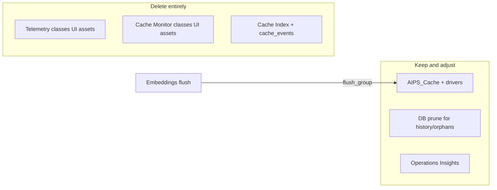

<!-- 29ecca12-ee40-4f38-907c-276f3aeb4b26 -->
---
todos:
  - id: "delete-files"
    content: "Delete Telemetry + Cache Monitor dedicated PHP/templates/assets/tests (including Cache Index + Monitorable interface)"
    status: pending
  - id: "strip-wiring"
    content: "Remove bootstrap, menu, hub tabs, assets, AJAX registry, DI bindings, and settings/config defaults"
    status: pending
  - id: "rename-prune-interval"
    content: "Rename aips_telemetry_prune_interval to aips_db_prune_interval (config, settings UI, cron resolve, option migration)"
    status: pending
  - id: "detangle-runtime"
    content: "Clean cache/observer/ops-insights/prune/diagnostics/cron/embeddings call sites; promote AIPS_Cache::flush_group"
    status: pending
  - id: "schema-migration"
    content: "Bump to 3.7.26; remove tables from DB manager; add migrate_to_3_7_26 drop/cleanup + prune-interval option rename"
    status: pending
  - id: "tests-docs-verify"
    content: "Update/remove affected tests and living docs; grep + run targeted PHPUnit"
    status: pending
isProject: false
---
# Remove Telemetry and Cache Monitor Subsystems

## Scope decisions

- **In scope:** Telemetry collection/UI/pruning + Cache Monitor UI/AJAX/cron + the Cache Index / cache-events tables that exist only to feed Cache Monitor.
- **Out of scope:** Core `AIPS_Cache` / `aips_cache` table / cache drivers’ basic get/set/delete/flush. History-log retention and orphan-cleanup pruning stay.
- **Version bump:** `3.7.25` → `3.7.26` in [`ai-post-scheduler/ai-post-scheduler.php`](ai-post-scheduler/ai-post-scheduler.php) so existing installs run a one-shot cleanup migration.
- **Group flush:** Promote `delete_group()` onto [`interface-aips-cache-driver.php`](ai-post-scheduler/includes/interface-aips-cache-driver.php) and add `AIPS_Cache::flush_group()`. Reuse existing driver implementations (DB/array already have it; WP object-cache keeps a safe no-op/false). [`class-aips-embeddings-repository.php`](ai-post-scheduler/includes/class-aips-embeddings-repository.php) will call `AIPS_Cache::flush_group('aips_embeddings')` instead of `AIPS_Cache_Monitor_Service`.

## 1. Delete dedicated subsystem files

**Telemetry**
- [`includes/class-aips-telemetry.php`](ai-post-scheduler/includes/class-aips-telemetry.php)
- [`includes/class-aips-telemetry-controller.php`](ai-post-scheduler/includes/class-aips-telemetry-controller.php)
- [`includes/class-aips-telemetry-repository.php`](ai-post-scheduler/includes/class-aips-telemetry-repository.php)
- [`templates/admin/telemetry.php`](ai-post-scheduler/templates/admin/telemetry.php)
- [`assets/js/telemetry.js`](ai-post-scheduler/assets/js/telemetry.js)
- [`assets/css/telemetry.css`](ai-post-scheduler/assets/css/telemetry.css)
- [`tests/Test_AIPS_Telemetry.php`](ai-post-scheduler/tests/Test_AIPS_Telemetry.php)

**Cache Monitor (+ index)**
- [`includes/class-aips-cache-monitor-service.php`](ai-post-scheduler/includes/class-aips-cache-monitor-service.php)
- [`includes/class-aips-cache-monitor-controller.php`](ai-post-scheduler/includes/class-aips-cache-monitor-controller.php)
- [`includes/class-aips-cache-monitor-repository.php`](ai-post-scheduler/includes/class-aips-cache-monitor-repository.php)
- [`includes/class-aips-cache-index.php`](ai-post-scheduler/includes/class-aips-cache-index.php)
- [`includes/interface-aips-cache-monitorable-driver.php`](ai-post-scheduler/includes/interface-aips-cache-monitorable-driver.php)
- [`templates/admin/cache-monitor.php`](ai-post-scheduler/templates/admin/cache-monitor.php)
- [`assets/js/cache-monitor.js`](ai-post-scheduler/assets/js/cache-monitor.js)

## 2. Strip bootstrap, menus, assets, AJAX, DI

| Area | File | Action |
|------|------|--------|
| Early boot | [`ai-post-scheduler.php`](ai-post-scheduler/ai-post-scheduler.php) | Remove `AIPS_REQUEST_START`, `SAVEQUERIES` telemetry gate, `AIPS_TELEMETRY_*` constants, Telemetry DI binding, `boot_common()` telemetry boot |
| Menu | [`class-aips-admin-menu.php`](ai-post-scheduler/includes/class-aips-admin-menu.php) | Remove `aips-telemetry` / `aips-cache-monitor` submenu registration + render redirect methods |
| Hub tabs | [`class-aips-diagnostics-controller.php`](ai-post-scheduler/includes/class-aips-diagnostics-controller.php), [`class-aips-admin-page-context.php`](ai-post-scheduler/includes/class-aips-admin-page-context.php) | Remove `telemetry` and `cache-monitor` tabs / slug aliases / availability checks |
| Assets | [`class-aips-admin-assets.php`](ai-post-scheduler/includes/class-aips-admin-assets.php) | Remove page constants, enqueue helpers, localized strings for both pages; drop system-status prune/purge telemetry nonces/strings |
| AJAX map | [`class-aips-ajax-registry.php`](ai-post-scheduler/includes/class-aips-ajax-registry.php) | Remove `aips_get_telemetry*`, `aips_status_prune/purge_telemetry`, all `aips_cache_monitor_*` actions |
| DI event hooks | [`class-aips-container.php`](ai-post-scheduler/includes/class-aips-container.php) | Remove all `AIPS_Telemetry::is_enabled()` / `add_event` class-init instrumentation |

## 3. Remove settings and config defaults

From [`class-aips-config.php`](ai-post-scheduler/includes/class-aips-config.php), [`class-aips-settings.php`](ai-post-scheduler/includes/class-aips-settings.php), [`class-aips-settings-ui.php`](ai-post-scheduler/includes/class-aips-settings-ui.php):

- Options to **delete**: `aips_enable_telemetry`, `aips_telemetry_retention_*`, `aips_cache_monitor_enabled`, and all other `aips_cache_monitor_*` defaults
- Field registrations + UI callbacks (`enable_telemetry_field_callback`, `cache_monitor_enabled_field_callback`, telemetry retention fields)
- Keep the broader Database Retention section for history logs / orphans; rewrite copy so it no longer mentions telemetry

Also clear the enable-telemetry toggle from [`scripts/setup-devstacktips-content.php`](ai-post-scheduler/scripts/setup-devstacktips-content.php).

### 3a. Rename prune-interval option (keep schedule for remaining retention)

`aips_telemetry_prune_interval` today drives the recurrence for the whole `aips_database_prune_cleanup` cron (history logs, orphans, topics — not telemetry alone). Rename it so remaining retention still has a schedule:

- **New option:** `aips_db_prune_interval` (default `daily`; same allowed values: `daily` / `twicedaily` / `weekly`)
- Update config defaults, `register_setting`, Settings UI field name/label/callback, and cron-sync hooks (`update_option_aips_db_prune_interval` / `add_option_*`)
- Update [`class-aips-cron-registry.php`](ai-post-scheduler/includes/class-aips-cron-registry.php) `resolve_prune_recurrence()` to read `aips_db_prune_interval`
- In `migrate_to_3_7_26()`: if old option exists, copy value into `aips_db_prune_interval`, then `delete_option('aips_telemetry_prune_interval')`; resync the `aips_database_prune_cleanup` schedule if auto-prune is enabled
- Update cron/settings tests and [`docs/performance-pruning-guide.md`](docs/performance-pruning-guide.md) option reference accordingly

## 4. Detangle runtime call sites

- [`class-aips-cache.php`](ai-post-scheduler/includes/class-aips-cache.php): remove Cache Index resolution/`record_*` calls and `record_cache_event` telemetry; add `flush_group($group)` backed by driver `delete_group` + L1 invalidation.
- Cache drivers ([`class-aips-cache-db-driver.php`](ai-post-scheduler/includes/class-aips-cache-db-driver.php), [`class-aips-cache-array-driver.php`](ai-post-scheduler/includes/class-aips-cache-array-driver.php), [`class-aips-cache-wp-object-cache-driver.php`](ai-post-scheduler/includes/class-aips-cache-wp-object-cache-driver.php)): drop `AIPS_Cache_Monitorable_Driver`; keep only `delete_group` (move onto `AIPS_Cache_Driver`); delete list/inspect/estimate/monitor-capability methods.
- [`class-aips-repository-cache-observer.php`](ai-post-scheduler/includes/class-aips-repository-cache-observer.php): remove telemetry emit path.
- [`class-aips-operations-insights-controller.php`](ai-post-scheduler/includes/class-aips-operations-insights-controller.php) + [`templates/admin/operations-insights.php`](ai-post-scheduler/templates/admin/operations-insights.php): always load retry counts from history (data was never from the telemetry table); remove `telemetry_enabled` gating/banner.
- [`class-aips-db-prune-service.php`](ai-post-scheduler/includes/class-aips-db-prune-service.php) + [`class-aips-system-diagnostics-service.php`](ai-post-scheduler/includes/class-aips-system-diagnostics-service.php) + [`class-aips-system-status-controller.php`](ai-post-scheduler/includes/class-aips-system-status-controller.php): remove telemetry prune/purge APIs, Refresh System `prune_telemetry` task, and Cache Monitor maintenance dependency.
- Templates [`system-status.php`](ai-post-scheduler/templates/admin/system-status.php) / [`system-health.php`](ai-post-scheduler/templates/admin/system-health.php): remove telemetry-table status/actions UI.
- JS [`admin-system-status.js`](ai-post-scheduler/assets/js/admin-system-status.js): remove prune/purge telemetry handlers; soften destructive Refresh copy to history/orphans only.
- [`class-aips-cron-registry.php`](ai-post-scheduler/includes/class-aips-cron-registry.php): remove `aips_cache_monitor_maintenance`; keep `aips_database_prune_cleanup` and point its recurrence at `aips_db_prune_interval` (section 3a).
- [`class-aips-system-info-provider.php`](ai-post-scheduler/includes/class-aips-system-info-provider.php): drop telemetry-enabled reporting.

## 5. Schema + upgrade migration

In [`class-aips-db-manager.php`](ai-post-scheduler/includes/class-aips-db-manager.php):
- Remove `aips_telemetry`, `aips_cache_index`, `aips_cache_events` from `$tables`, `CREATE TABLE` SQL, and any table-status metadata maps so new installs never create them.

In [`class-aips-db-migrations.php`](ai-post-scheduler/includes/class-aips-db-migrations.php), add `migrate_to_3_7_26()` that:
1. `DROP TABLE IF EXISTS` `{prefix}aips_telemetry`, `{prefix}aips_cache_index`, `{prefix}aips_cache_events`
2. Migrate prune interval: copy `aips_telemetry_prune_interval` → `aips_db_prune_interval` (if present), then delete the old option; leave schedule intact for remaining retention
3. `delete_option` for all removed Telemetry / Cache Monitor settings listed in section 3
4. `wp_clear_scheduled_hook` for `aips_cache_monitor_maintenance`
5. Gate with `version_compare( $from_version, '3.7.26', '<' )` before stamping `aips_db_version`

## 6. Tests and living docs

**Tests to delete or rewrite**
- Delete `Test_AIPS_Telemetry.php`
- Update: `Test_AIPS_Container_Bindings`, `Test_AIPS_Admin_Menu` (cache monitor registration), `Test_AIPS_Admin_Page_Context`, `Test_AIPS_Diagnostics_Embedded_Templates`, `Test_AIPS_Cron_Registry` / `Test_AIPS_Cron_Manager`, `Test_AIPS_System_Diagnostics_Service`, `Test_AIPS_Cache` (index + telemetry assertions), `Test_AIPS_Performance_Hardening` (cache index), `Test_AIPS_Repository_Insert_Id`

**Docs (living only)**
- Update [`docs/AI_AGENT_REFERENCE.md`](docs/AI_AGENT_REFERENCE.md) and [`docs/performance-pruning-guide.md`](docs/performance-pruning-guide.md) to remove telemetry/cache-monitor surface area.
- Leave historical plan notes under `docs/superpowers/` / `docs/css-variables-audit.md` untouched unless they block understanding.

## 7. Verification

- Grep the repo for `telemetry`, `cache_monitor`, `Cache_Monitor`, `Cache_Index`, `aips_telemetry`, `aips_cache_index`, `aips_cache_events` and ensure only intentional historical-doc leftovers remain.
- Run the affected PHPUnit suites (container, admin menu, cache, cron, diagnostics, DB migrations).
- Spot-check Diagnostics hub: no Telemetry/Cache Monitor tabs; Settings has no enable toggles; System Status has no prune/purge telemetry actions.